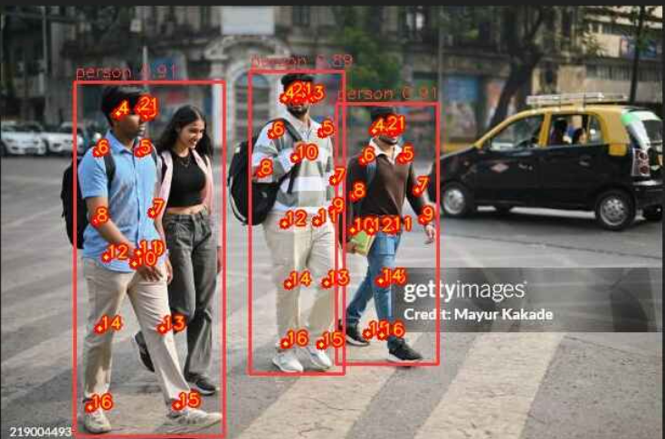
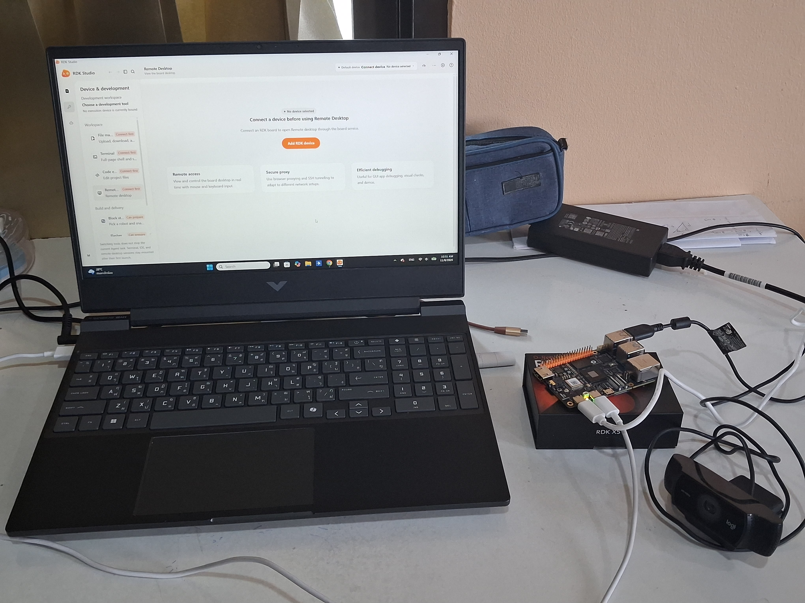
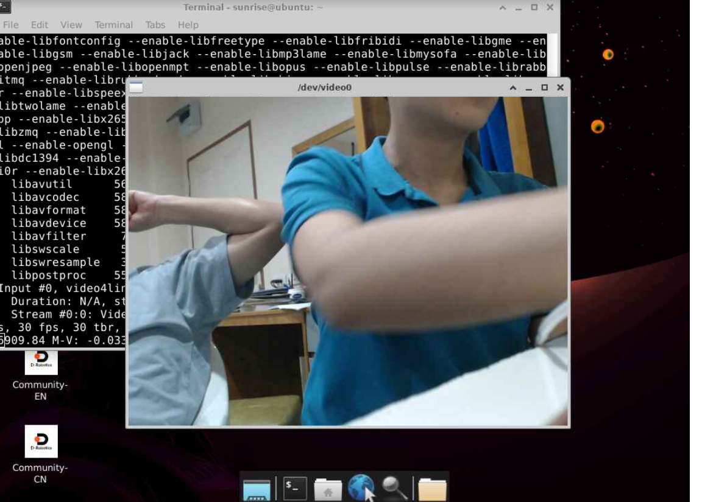

# rdk-x5-stage1 — RDK X5 Robotics Project

**Robotics Dream Keeper Challenge — Winter 2026**

- **Participant:** Mark
- **Project:** rdk-x5-stage1-demo
- **Current stage:** Stage 1 — Ignite
- **Hardware:** D-Robotics RDK X5
- **Repository status:** Development

---

## Demonstration

The RDK board is sucessfully able to boot up Ubuntu, connect to the computer using remote desktop, and run /app/ Yolo11 demos

### Main Result



**What this demonstrates:**

- The board is able to request video/0/ from connected usb webcam
- The demo Yolo11 pose model is able to run fluently

## Project Overview

### Approach

Our project approach is to first understand foundational part of our hardware and software. After that, we will experiment with ROS2 and AI models.

### Objectives

- 1.Learn the fundementals
- 2.Try ROS
- 3.Proceed with the project goal.

## Hardware

| Component | Model / Specification | Purpose |
|---|---|---|
| Development board | D-Robotics RDK X5 | Main computing platform |
| Storage | microSD card | System storage and Boot Firmware |
| Camera | Usb Webcam | Video Capture |
| Sensor | LiDar / N/A | Navigation |
| Actuator | Motor - Future goal | Movement |
| Development PC | Laptop | Development and remote access |

### Hardware Setup


*stage 1*

**Connection details:**
| Component | Connection | Purpose |
|---|---|---|
| Development board | USB Port+Cable | Remote desktop |
| MicroSD card | MicroSD card port | System storage and Boot Firmware |
| USB Webcam | USB connection | Video Capture |
| USB power supply cable | USB cable + Adapter | Charging RDK |
| Development laptop | - | Programming and Screen |


## Tested Software Environment

Record the actual versions running on your tested hardware.

| Component | Version / Configuration |
|---|---|
| RDK OS | [RDK OS v3.5.0 Image](https://archive.d-robotics.cc/downloads/os_images/rdk_x5/rdk_os_3.5.0-2026-4-9/rdk-x5-ubuntu22-preinstalled-desktop-3.5.0-arm64.img.xz) |
| Ubuntu | Ubuntu 22.04.5 LTS (GNU/Linux 6.1.83 aarch64) |
| Linux kernel | v6.1.83 |
| CPU architecture | aarch64 |
| Python | 3.15.2 |
| ROS 2 | Not used yet |
| Other dependencies | ffmpeg |

## Project Architecture

Our RDK x5 board boot up with RDK os v3.5.0 via the MicroSD card. We then remote desktop to our board via USB 2.0 Quicklink. This way we can configure the board's wifi connection, thus allowing us to ssh to it via the connected wifi endpoint. After that, we attach USB webcam via the USB port and capture video and image using ffmpeg. We also tried experimenting the /app/ demo by using python to run the example program and input our captured image as parameter.  

### Architecture Diagram

```text
[USB Camera/Image online]
        |
        v
[Demo /app/ programs]
        |
        v
[RDK X5 BPU / CPU]
        |
        v
[Image Output]
        |
        v
[FFmpeg Display / Result]
```

### Architecture Explanation

1. **Input:** Image captured from either the USB Camera or the web
2. **Inference / Logic:** Data is processed through the demo programs
3. **Output:** Displayed Via FFmpeg in the terminal

## Repository Structure

```text
rdk-x5-stage1/
|
+-- .gitignore
+-- README.md
+-- LICENSE
+-- requirements.txt
|
+-- src/
+-- docs/
|   +-- architecture/
|   +-- setup/
|
+-- evidence/
    +-- Flash_ssh.log
    +-- Sensor.png
    +-- Yolo11_demo.png
    +-- Yolo11_original.png
    +-- hardware.png
```

## Prerequisites and Dependencies

### Hardware Requirements

- RDK X5 hardware
- USB webcam
- microSD card and USB MicroSD card reader
- 2x USB cables + Adapters

### Software Requirements

- [RDK OS v3.5.0 Image](https://archive.d-robotics.cc/downloads/os_images/rdk_x5/rdk_os_3.5.0-2026-4-9/rdk-x5-ubuntu22-preinstalled-desktop-3.5.0-arm64.img.xz)
- Python 3.15.2

### Dependencies

| Dependency | Version | Purpose |
|---|---|---|
| FFmpeg | 9.0.2 | Image/Video capture |

## Installation and Setup

### 1. Prepare the RDK X5

  Download system image via [RDK OS v3.5.0 Image](https://archive.d-robotics.cc/downloads/os_images/rdk_x5/rdk_os_3.5.0-2026-4-9/rdk-x5-ubuntu22-preinstalled-desktop-3.5.0-arm64.img.xz)
  Download [Rufus](https://rufus.ie/en/)

- 1.Boot up rufus and flash the system image downloaded into the MicroSD card attached via the USB MicroSD card reader.
- 2.Disconnect the card reader and put the MicroSD card into the RDK x5 board's microSD card slot.
- 3.Boot up RDK board via USB charging port using a USB adapter (+cable).

### 2. Connect to the RDK X5

## 1.Booting up RDK os

- After booting up the board with RDK os successfully, proceed with [RDK Studio](https://developer.d-robotics.cc/en/rdkstudio?ref=drobotics.ghost.io) software
- Next, connect the pc with the board via a USB cable connected by the USB quicklink port.
- Inside RDK Studio, signin with your account and click into <Device & Development> tab and select <Remote Desktop>

## 2.Setting up SSH

- In OS desktop, select Applications>RDK Configuration, there a terminal window will popup.
- In the terminal window, use the arrow keys to select <I1 SSH>, press enter and enable the SSH service
- Finally, exit the terminal window and use the cmd or powershell from your laptop to ssh to the board using this command:
  
```bash
ssh root@<<Your board IP>>
```

**Evidence:**

[SSH Connection](evidence/Flash_ssh.log)

### 4. Configure Hardware/Camera

For this demo project, configuring hardware is really simple. In fact, because in this project we use only the webcam, all we need to do is to connect it and capture images and videos from the webcam using ffmpeg using the following steps:

- 1.For capturing videos, do:
  
```bash
sudo apt install v4l-utils
v4l2-ctl --list-devices
ffplay /dev/video0   ##replace /video0 with whatever /video[num] your webcam have
```

- 2.For taking and saving pictures, do:

```bash
ffmpeg -f v4l2 -video_size 1920x1080 -i /dev/video0 -vframes 1 <<Your directory path>>/photo.jpg
```

**Evidence:**



## Running the Demo

### 1. Navigation

Navigate to the /app/pydev_demo/ and select the demo as of your uses. For this exampke I'll be using pose detection:

```bash
cd /app/pydev_demo/04_pose_sample/01_ultralytics_yolo11_pose/
```

### 2. Run the Demo

Run the demo by using python:

```bash
python ultralytics_yolo11_pose.py
```

### 3. Model Output

## Original.png


## Result


**Observed result:**

The model successfully identifies the people walking on the crosswalk.


## Results and Verification

Record actual observations from your experiments.

| Test | Configuration | Actual Result | Status |
|---|---|---|---|
| System boot | [Configuration] | [Observed result] | [Status] |
| Network / SSH | [Configuration] | [Observed result] | [Status] |
| Sensor | [Configuration] | [Observed result] | [Status] |
| AI inference | [Configuration] | [Observed result] | [Status] |
| Actuator | [Configuration] | [Observed result] | [Status] |

### Performance Measurements

Only include measurements you have actually taken.

| Metric | Measurement | Test Conditions |
|---|---|---|
| Inference latency | N/A | - |
| Inference throughput | N/A | - |
| CPU utilization | N/A | - |
| BPU utilization | N/A | - |
| Memory usage | N/A | - |
| Temperature | N/A | - |
| Power consumption | N/A] | - |

### Additional Evidence

- [Demonstration video](YOUR_VIDEO_LINK) - #todo
- [Detailed experiment report](YOUR_DOCUMENTATION_LINK) - #todo

## Troubleshooting

### [Problem 1]

**Symptoms:**

[What happens?]

**Possible cause:**

[What caused the problem?]

**Solution:**

[How did you resolve it?]

### [Problem 2]

**Symptoms:**

[What happens?]

**Possible cause:**

[What caused the problem?]

**Solution:**

[How did you resolve it?]

## Known Limitations

- Remote Desktop speed

## Future Development

### Next Challenge Stages

| Stage | Planned development |
|---|---|
| Stage 1 — Ignite | Initial hardware and AI demonstration |
| Stage 2 — Build | Further development and integration |
| Stage 3 — Launch | Complete project demonstration and evaluation |

## License

This project's original materials are licensed under [Your License].

See [LICENSE](LICENSE) for details.

Third-party components remain subject to their respective licenses.

## Challenge Information

**Program:** Robotics Dream Keeper Challenge 2026 Winter

**Organizer:** D-Robotics

**Current stage:** Stage 1

- [Official Challenge Repository](https://github.com/D-Robotics/Robotics-Dream-Keeper-Challenge-Winter)
- [Project Showcase](YOUR_SHOWCASE_PR_URL)
- [Community Update](https://discord.com/channels/1300358874280230994/1503706103752429618/threads/1565947368782831757)
